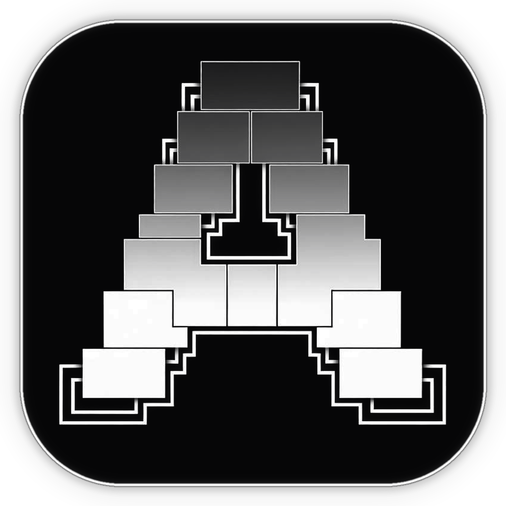

<div align="center">

  

  <h1 align="center">ArcadeX</h1>

  <p align="center">
    <strong>ArcadeX is an offline-capable, local-first desktop game library and game-management application. Built with Electron, React, TypeScript, and Rust.</strong>
  </p>

</div>

---

## 🎮 Features

- **Local-First & Offline Ready:** No mandatory account, no remote login required, and no remote server dependencies. Your games, playtime, and settings remain on your machine.
- **Unified Game Library:** Detect and manage all your installed PC games, Epic Games (via Legendary), and emulated classics in one unified launcher.
- **Emulation Management:** Deep integration with popular emulators including RetroArch, Dolphin, PCSX2, RPCS3, DuckStation, and PPSSPP.
- **Playtime & Session Tracking:** Accurate local playtime tracking with detailed statistics and history.
- **Local Save Game Backups:** Save detection and backup management powered by Ludusavi.
- **Achievements:** Local achievement tracking with unlock notifications and custom sound effects.
- **High-Performance Torrent Engine:** Embedded native Rust engine powered by libtorrent for fast, lawful downloads.
- **Extensible Metadata Architecture:** Provider-agnostic catalogue architecture ready for lawful metadata providers (such as IGDB via backend proxy).
- **Themes & Customization:** Highly customizable UI with custom CSS theming support.

---

## 🛡️ Lawful & User-Owned Games

ArcadeX is built exclusively for user-owned games, personal backups, homebrew, and authorized download sources. ArcadeX does not include or endorse unauthorized game distribution or DRM bypasses.

---

## ⚙️ Building From Source

### Prerequisites

- **Node.js** (v20+ recommended)
- **Yarn** (`npx yarn`)
- **Rust Toolchain** (`cargo`, `rustc` for native addon compilation)
- **C++ Build Tools** (Visual Studio C++ Build Tools on Windows, GCC/Clang on Linux, Xcode on macOS)
- **Python** (optional, for auxiliary tools)

### Installation & Setup

1. **Clone the repository:**
   ```bash
   git clone https://github.com/NamanGaonkar/ARCADE.git
   cd ARCADE
   ```

2. **Install dependencies:**
   ```bash
   npx yarn install
   ```

3. **Start development mode:**
   ```bash
   npx yarn dev
   ```

4. **Package native Windows installer:**
   ```bash
   # Windows installer (.exe) & portable (.exe)
   npx yarn build:win
   ```

---

## 🔌 Metadata Provider Configuration

ArcadeX uses a provider-agnostic catalogue layer. To integrate external metadata (such as IGDB):
- Configure your self-hosted proxy endpoint using `ARCADEX_METADATA_PROXY_URL`.
- Client credentials or secrets must **never** be hardcoded into the client app.

---

## 📄 License

ArcadeX is licensed under the [MIT License](LICENSE).
Original copyright and notices are preserved in accordance with the MIT license terms.
